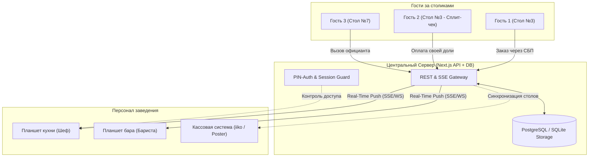

# Дорожная карта и план развития: Умное цифровое меню (Smart Menu)

Документ содержит результаты архитектурного анализа текущей версии цифрового меню и детализированный пошаговый план модернизации для вывода системы на коммерческий enterprise-уровень.

---

## 1. Текущий статус продукта

На текущем этапе разработан полнофункциональный клиентский прототип на стеке **Next.js 16 (App Router) + React 19 + TypeScript + Tailwind CSS v4**:
- ✅ **Гостевой интерфейс**: автоопределение столика по QR-коду (`?table=X`), фильтрация по диетам, поиск, КБЖУ, бейджи.
- ✅ **Smart-механики**: рекомендации под текущую погоду, кросс-селл (Upsell) в карточке блюда, калькулятор сплит-чека на компанию (СБП QR).
- ✅ **Сервисные функции**: вызов персонала по 4 сценариям, чаевые, списание бонусов заведения Aura Club.
- ✅ **Рабочее место персонала (KDS)**: канбан-доска чеков с прогрессией статусов, стоп-лист в 1 клик, прием вызовов, генератор и печать тейбл-тентов.

---

## 2. Сравнительный анализ (Gap Analysis)

| Направление | Текущее состояние (MVP) | Коммерческий Enterprise-стандарт | Приоритет |
| :--- | :--- | :--- | :--- |
| **Синхронизация данных** | Вкладки одного браузера | Server-Sent Events (SSE) / WebSockets между смартфонами и планшетами | **P0 (Критично)** |
| **Оповещения кухни** | Только визуальные индикаторы | Звуковой зуммер (Web Audio API) + push-уведомления на умные часы официантов | **P0 (Критично)** |
| **Безопасность админки** | Открытый доступ по URL `/admin` | Цифровой PIN-код экран (4 цифры) с разграничением ролей (шеф, бариста, менеджер) | **P1 (Высокий)** |
| **Эквайринг и чеки** | Симуляция оплаты | Настоящий шлюз СБП (ЮKassa / Т-Банк) + фискализация (54-ФЗ, Атол Онлайн) | **P1 (Высокий)** |
| **Синхронизация с кассой** | Автономная БД блюд | Двусторонний API-мост с POS-системами (**iiko**, **r-keeper**, **Poster**) | **P2 (Средний)** |
| **AI и Персонализация** | Статические алгоритмы рекомендаций | LLM AI-Сомелье в чате (рекомендации вина, учет аллергий на лету) | **P2 (Средний)** |
| **Автономность (PWA)** | Обычный Web SPA | Service Worker + кэширование каталога при нестабильном Wi-Fi в подвале | **P3 (Низкий)** |

---

## 3. Архитектурная схема взаимодействия устройств

---

## 4. Детализированный план внедрения по этапам

### Этап 1. Real-Time синхронизация и звуковой модуль кухни
**Цель:** Обеспечить работу разных физических устройств (телефон гостя и планшет кухни) в едином информационном пространстве.

1. **Серверные API маршруты**:
   - `POST /api/orders` — создание заказа со столика с валидацией состава и цен.
   - `GET /api/orders/live` — Server-Sent Events (SSE) поток для моментальной доставки новых чеков на кухню за <50 мс.
   - `PATCH /api/orders/:id/status` — обновление статуса блюда (`cooking`, `ready`, `served`).
   - `POST /api/waiter-calls` и `PATCH /api/waiter-calls/:id` — жизненный цикл вызовов персонала.
   - `GET /api/stoplist` и `POST /api/stoplist/toggle` — централизованный стоп-лист.
2. **Звуковой движок кухни (Audio Alert)**:
   - Синтез звукового сигнала через Web Audio API (громкий звонкий двойной колокольчик при новом чеке, вибросигнал на мобильных).
   - Индикатор активности звука в шапке (разблокировка воспроизведения по первому клику).

---

### Этап 2. Безопасность и авторизация персонала (Staff Shield)
**Цель:** Исключить доступ посторонних посетителей к панели управления и обезопасить кассовую дисциплину.

1. **PIN-Pad авторизация на `/admin`**:
   - Интерактивная экранная цифровая клавиатура (Numpad) на весь экран при переходе в админку.
   - Хеширование PIN-кодов (быстрый вход по 4 цифрам).
   - Ролевая модель:
     - `Официант` — видит только вызовы зала и готовые к выдаче заказы.
     - `Повар / Бариста` — видит входящие чеки и управляет стоп-листом кухни.
     - `Управляющий / Владелец` — полный доступ + отчетность и аналитика смены.
2. **Защита от фейковых заказов (Anti-Fraud)**:
   - Сессионный токен столика в QR-коде (гость не может отправить заказ за чужой стол, если не находится физически в заведении).

---

### Этап 3. Реальный эквайринг и фискализация (54-ФЗ)
**Цель:** Автоматический прием денег на расчетный счет кафе без участия официанта.

1. **Платёжный шлюз СБП**:
   - Интеграция с API **ЮKassa** / **Т-Банк Эквайринг** / **PayMaster**.
   - Генерация реальной ссылки `sbp://` для бесшовного перехода в банковское приложение гостя.
   - Webhook-обработчик подтверждения платежа (`payment.succeeded`).
2. **Автоматическая фискализация**:
   - Интеграция с облачной кассой (**Атол Онлайн**, **Orange Data** или **CloudKassir**).
   - Генерация чека с номенклатурой позиций и отправка ссылки на чек по SMS или email гостю.

---

### Этап 4. Интеграция с кассовыми системами (POS Integration)
**Цель:** Исключить двойной ввод данных персоналом и синхронизировать списания продуктов на складе.

1. **iiko Cloud API / Poster POS / r-keeper**:
   - Автоматическая выгрузка актуального меню с модификаторами и ценами прямо из кассы ресторана.
   - Прямой проброс созданного гостем заказа в кассовую систему как «Открытый заказ на Стол №X».
   - Автоматическое списание ингредиентов со склада по технологическим картам кафе.
2. **Сетевая печать чеков-бегунков (ESC/POS)**:
   - Отправка команды прямой печати на кухонный термопринтер (Epson / Star Micronics / Xprinter) по протоколу TCP/IP (порт 9100).

---

### Этап 5. Продвинутый AI-маркетинг и автономность
**Цель:** Повышение среднего чека на 15–25% и улучшение пользовательского опыта.

1. **Интеллектуальный AI-Сомелье / Бариста**:
   - Диалоговый агент на базе LLM в углу экрана:  
     *«Хочу что-то сладкое, но низкокалорийное к фильтр-кофе»* ➔ агент анализирует состав и рекомендует подходящий десерт с кнопкой добавления в корзину.
2. **Динамическое ценообразование (Dynamic Pricing & Happy Hours)**:
   - Автоматическое применение скидок на свежую выпечку после 20:00 (уменьшение вечерних списаний).
   - Автоматическое скрытие утренней категории завтраков ровно в 12:00.
3. **Мультиязычность (i18n)**:
   - Поддержка русского, английского и китайского языков с мгновенным переключением.
4. **PWA (Progressive Web App)**:
   - Оффлайн-кэширование через Service Worker на случай слабого покрытия мобильной сети в цокольных этажах.

---

## 5. Матрица трудозатрат и приоритетов

| Этап | Задачи | Срок реализации | Бизнес-эффект |
| :--- | :--- | :--- | :--- |
| **Спринт 1** | API + SSE real-time синхронизация + Audio-звонок кухни + PIN-код админки | **3–4 дня** | Готовая к полевым тестам система на реальных смартфонах и планшетах |
| **Спринт 2** | Подключение боевого СБП (ЮKassa / Т-Банк) + онлайн-чеки (54-ФЗ) | **4–5 дней** | Гости могут реально оплачивать со стола, снижая нагрузку на официантов |
| **Спринт 3** | Интеграция с ресторанным ПО (iiko Cloud / Poster API) | **5–7 дней** | Полная автоматизация склада и кассы без ручного переноса чеков |
| **Спринт 4** | AI-сомелье, Happy Hours, мультиязычность и PWA | **3–4 дня** | Рост конверсии, среднего чека и повторных визитов |
